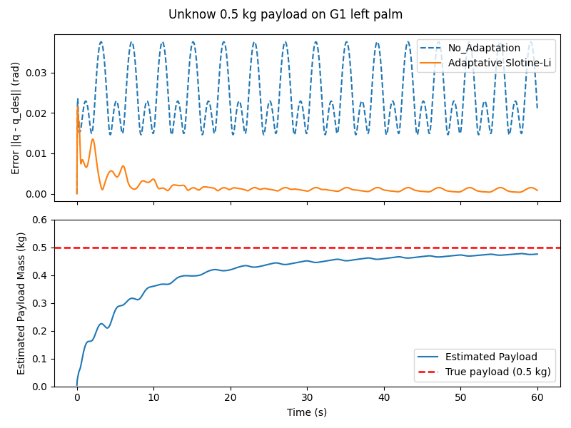

# Adaptive Manipulation with Slotine–Li Adaptive Control and Reinforcement Learning

> Work in progress (started September 2026).
> **Milestone 1 complete:** Slotine–Li adaptive control of the G1 left arm under an unknown payload.
> No RL training results yet.

## Goal
Enable a robot arm and hand to lift objects of unknown and varying mass, staying robust to
out-of-distribution payloads while learning from limited data. The approach combines a learned
policy (PPO) with classical adaptive control (Slotine–Li), whose Lyapunov-based analysis
guarantees bounded parameter estimates and convergence of the tracking error.

## Milestone 1 result: adapting to an unknown payload



*Left arm of the Unitree G1 (Isaac Sim) tracking a sinusoidal joint trajectory with an unknown
0.5 kg payload on the palm. The fixed model-based controller sags persistently; the Slotine–Li
adaptive controller estimates the payload online and recovers tracking.*

| Controller | Mean tracking error, last 10 s | Mass estimate after 60 s |
|---|---|---|
| Model-based, no adaptation | 0.0254 rad | – |
| Slotine–Li adaptive | 0.00089 rad (≈ 29× lower) | 0.475 kg (true 0.5 kg) |

No policy is involved yet: the arm follows a scripted trajectory, so this isolates the
controller.

## Method
The left arm (5 joints) runs in effort mode; the hand stays on PD position control with a 1-D
synergy. With tracking error $\tilde q = q - q_d$, reference velocity
$\dot q_r = \dot q_d - \Lambda\tilde q$ and sliding variable $s = \dot q - \dot q_r = \dot{\tilde q} + \Lambda\tilde q$:

**Control law**

$$
\tau = \underbrace{M(q)\ddot q_r + C(q,\dot q)\dot q_r + g(q)}_{\text{arm, known from the URDF}}
+ \underbrace{Y_{\text{obj}}(q,\dot q,\dot q_r,\ddot q_r)\,\hat\theta}_{\text{payload, estimated}} - K s
$$

**Adaptation law**

$$
\dot{\hat\theta} = -\Gamma\, Y_{\text{obj}}^{\mathsf T}(q,\dot q,\dot q_r,\ddot q_r)\, s
$$

The control law cancels the modelled dynamics and adds damping on $s$; the adaptation law updates
the payload estimate $\hat\theta$ in the direction that reduces the tracking error. With
$V = \tfrac12 s^{\mathsf T} M s + \tfrac12\tilde\theta^{\mathsf T}\Gamma^{-1}\tilde\theta$, these give
$\dot V = -s^{\mathsf T} K s \le 0$, so $s$ and $\tilde\theta$ stay bounded, and for a bounded,
twice-differentiable reference trajectory, Barbalat's lemma gives $s \to 0$ and the tracking error
converges. The parameter estimates stay bounded but need not
converge to the true values unless the motion is sufficiently exciting.

- **Arm model:** computed with Pinocchio from a URDF converted from the Isaac Lab USD; joints are
  matched to Isaac by name, and motor armature is included.
- **Payload model:** the payload's 10 inertial parameters (mass, first moments, inertia about the
  palm frame) enter linearly. $Y_{\text{obj}} = J_{\text{palm}}^{\mathsf T} A$, where $A$ is
  Pinocchio's body regressor at the palm; the Coriolis term with $\dot q_r$ uses the
  polarization identity, so the regressor is built from three regressor evaluations.
- **Adaptation gains:** $\Gamma$ adapts the mass and first moments and freezes the inertia terms,
  which this slow trajectory barely excites. The Lyapunov argument applies to the adapted subset.
- No joint accelerations are measured.
- The Pinocchio arm model was checked against Isaac Sim (gravity) before use, so the adaptation
  learns the payload rather than arm-model errors; see [`validation/`](validation/README.md).

**Assumptions**
1. **Rigid bodies, fixed base.** All links and the payload are rigid; the pelvis is fixed
   (`fix_root_link=True`), so the arm is a fixed-base serial chain.
2. **Frictionless joints.** Joint friction and damping are not modelled; the arm's built-in PD
   drive is switched off.
3. **Known arm.** The arm's own inertial parameters (from the URDF) and motor armature (from
   Isaac) are known; only the payload is unknown.
4. **Rigidly attached, constant payload.** The payload moves with the palm and its 10 inertial
   parameters are constant (no slipping).
5. **Measured state.** Joint positions and velocities are measured without noise; joint
   accelerations are not used.
6. **Hand as part of the arm model.** The hand stays on PD position control; its links are
   included in the arm model at their measured positions and velocities, but the effect of the
   hand's accelerations on the arm is neglected.
7. **No torque saturation.** Commanded torques stay within the joint effort limits. The analysis
   is in continuous time; the controller runs at 200 Hz with Euler integration of $\hat\theta$.

## Status
- [x] PPO re-implemented from scratch in PyTorch, following the rsl_rl architecture
- [x] Joint-motion and hand-synergy test scripts for the G1 left arm and hand
- [x] Unitree G1 arm–hand grasp environment defined in Isaac Lab (NVIDIA Isaac Sim 6.0)
- [x] Pinocchio model of the G1 validated against Isaac Sim (gravity, see [`validation/`](validation/README.md))
- [x] Pinocchio-based online computation of the arm model and payload regressor
      (checked against Pinocchio's own algorithms to ~1e-15)
- [x] Slotine–Li adaptive control law implemented and tested with an unknown palm payload (Milestone 1)
- [ ] Add arm actions so the policy can lift, not only grasp (policy outputs arm targets, the adaptive controller tracks them)
- [ ] Randomize object mass during training (currently fixed at 0.2 kg)
- [ ] Connecting PPO to the G1 environment for training (`g1_grasp_train.py` is a placeholder loop)
- [ ] Combining the adaptive controller with the learned policy
- [ ] Evaluation on out-of-distribution payload masses, against PD and pure-PPO baselines

## Repository structure
```
ppo/                         PPO written from scratch in PyTorch
  actor.py                   Gaussian actor (learned log-std) and critic MLPs
  PPO.py                     Clipped-surrogate update, entropy bonus, grad clipping, KL / clip-fraction metrics
  rollout_buffer.py          Rollout storage, GAE, advantage normalisation, minibatching
  rollout_collector.py       Rollout collection with timeout bootstrapping
controller/
  my_pin_model.py            Pinocchio wrapper: Isaac <-> Pinocchio joint mapping, arm model torque,
                             palm and payload regressors
  slotine_li_controller.py   Slotine–Li adaptive controller (control law + adaptation law)
envs/
  g1_grasp_build.py          Isaac Lab DirectRLEnv: fixed-base G1, left arm + hand, cube on a platform,
                             34-D observation, 1-D hand-synergy action (open <-> close).
                             First step: grasp only. Arm control for lifting comes next.
  g1_grasp_train.py          Registers the env as G1-Grasp-v0 (work in progress, see below)
experiments/
  payload_adaptation/        Milestone 1: arm tracking with an unknown palm payload
    g1_test_build.py         Env: arm in effort mode under the Slotine–Li controller, payload added to the palm
    g1_test_train.py         Runner: --payload <kg>, --adapt
    offline_adapt_test.py    Controller sanity checks without Isaac Sim
    plot_adaptation.py       Produces the figure above from the two run logs
    figures/
tools/
  joint_motion_test.py       Moves one joint at a time with a sine wave to inspect each joint's motion
  open_close_test.py         Sweeps the hand synergy to check each finger's closing direction
  usd_to_urdf.py             Converts the Isaac Lab G1 USD into a dynamics-only URDF for Pinocchio
validation/                  Gravity check: Pinocchio's model of the G1 arm vs Isaac Sim
```

## Requirements
- NVIDIA Isaac Sim 6.0 and Isaac Lab (installed separately; developed with Isaac Sim 6.0.1 and Isaac Lab 6.1.14)
- Python 3.12
- Python packages: see `requirements.txt`
- Pinocchio: install from conda-forge (`conda install -c conda-forge pinocchio`); there are no
  pip wheels for Windows

The URDF used by Pinocchio is not included in this repository. Generate it from the Isaac Lab
G1 USD with:

```bash
python tools/usd_to_urdf.py <path-to-g1.usd> assets/g1_37dof.urdf
```

## How to run
Scripts are launched through Isaac Lab's launcher from the Isaac Lab directory (Windows shown;
use `isaaclab.sh` on Linux). Isaac Lab launcher flags such as `--headless` and `--device` are supported.

```bash
# Sweep the G1 hand synergy (open -> close) to check finger directions
isaaclab.bat -p <path-to-repo>/tools/open_close_test.py --num_envs 1

# Move each left-arm and hand joint in turn with a sine wave
isaaclab.bat -p <path-to-repo>/tools/joint_motion_test.py --num_envs 1

# Milestone 1: unknown 0.5 kg payload, without and with adaptation
isaaclab.bat -p <path-to-repo>/experiments/payload_adaptation/g1_test_train.py --payload 0.5
isaaclab.bat -p <path-to-repo>/experiments/payload_adaptation/g1_test_train.py --payload 0.5 --adapt
python <path-to-repo>/experiments/payload_adaptation/plot_adaptation.py
```

`envs/g1_grasp_train.py` is not finished. It registers the G1 grasp env as a Gymnasium environment
(`G1-Grasp-v0`) and imports the PPO modules from `ppo/`, but PPO is not connected yet: the script
currently steps the environment with zero actions as a placeholder. No training happens yet.

## Next
Combine the adaptive controller with the learned policy: PPO decides where the arm and hand
should go, and the Slotine–Li controller tracks those targets while adapting to the object's
unknown mass. This works toward the main goal of lifting objects of unknown and varying mass
from limited data.

## Acknowledgements
The PPO implementation follows the architecture of
[rsl_rl](https://github.com/leggedrobotics/rsl_rl) (BSD-3-Clause).
The environments are built on [Isaac Lab](https://github.com/isaac-sim/IsaacLab) (BSD-3-Clause)
and use its Unitree G1 asset configuration. Rigid-body dynamics are computed with
[Pinocchio](https://github.com/stack-of-tasks/pinocchio).
The adaptive controller follows J.-J. E. Slotine and W. Li, "On the Adaptive Control of Robot
Manipulators," *The International Journal of Robotics Research*, 6(3), 1987.
