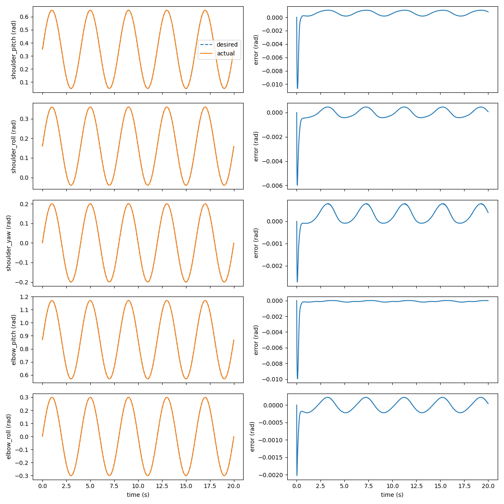
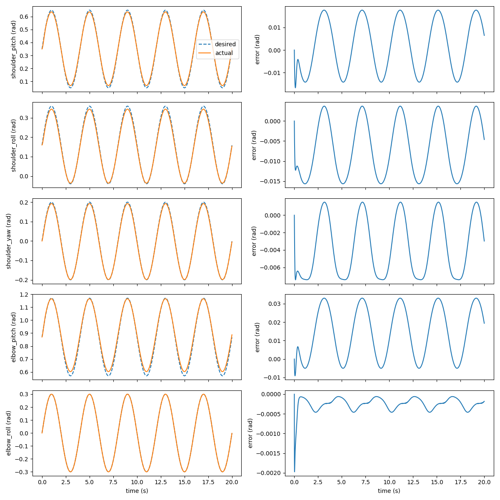
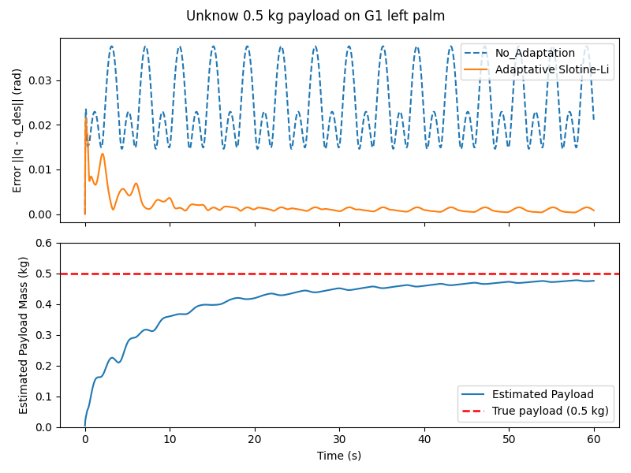

# Payload adaptation: Slotine–Li control of the G1 left arm

> Milestone 1. The method, the stability argument and the assumptions are in the
> [main README](../../README.md#method); this page covers the experiment itself.

The left arm of a fixed-base Unitree G1 in Isaac Sim tracks a sinusoidal joint trajectory with
its PD drive switched off, so all arm torques come from the controller. A payload is added to
the palm at start-up without telling the controller. We compare:

1. the model-based controller with no payload (does the arm model match the simulator?),
2. the same controller with an unknown 0.5 kg payload (what does the model error cost?),
3. the Slotine–Li adaptive controller with the same payload (can it estimate the payload and
   recover?).

## Setup
| | |
|---|---|
| Robot | Unitree G1 (Isaac Lab `G1_CFG`), pelvis fixed (`fix_root_link=True`) |
| Arm | 5 left-arm joints in effort mode, built-in PD off, torques clamped to the joint effort limits |
| Hand | PD position control, 1-D open/close synergy (0.25 Hz) |
| Trajectory | $q_d(t) = q_0 + A\sin(\omega t)$ around Isaac Lab's default pose, $A = [0.3, 0.2, 0.2, 0.3, 0.3]$ rad, $\omega = 2\pi \cdot 0.25$ rad/s |
| Control rate | 200 Hz (physics `dt = 0.005` s) |
| Gains | $\Lambda = 10\,I$, $K = \mathrm{diag}(5, 5, 3, 3, 1)$ |
| Adaptation gain | $\Gamma = \mathrm{diag}(1, 0.1, 0.1, 0.1, 0, \dots, 0)$: mass and first moments adapted, inertia terms frozen |
| Payload | added to the mass of `left_palm_link` in PhysX at start-up; the controller's Pinocchio model is not changed |
| Initial estimate | $\hat\theta_{\text{obj}} = 0$ (the controller assumes no payload) |

With adaptation off, the controller is the same control law with $\hat\theta_{\text{obj}}$ fixed at
zero, i.e. a model-based controller that knows the arm but not the payload.

## Files
| File | Role |
|---|---|
| `g1_test_build.py` | Isaac Lab environment: arm in effort mode under the Slotine–Li controller, payload added to the palm, logs $q$, $q_d$, $s$, $\tau$ and $\hat\theta_{\text{obj}}$ every physics step |
| `g1_test_train.py` | Runner: `--payload <kg>` (default 1.0), `--adapt` to enable adaptation; runs 60 s and saves `logs/track_log_<fixed\|adapt>_m<payload>.npz` at the repository root |
| `offline_adapt_test.py` | Controller sanity checks without Isaac Sim (needs only Pinocchio and the URDF) |
| `plot_adaptation.py` | Plots the fixed and adaptive runs with a 0.5 kg payload and saves `figures/payload_adaptation.png` |
| `figures/` | Plots from our runs |

The controller itself lives in [`../../controller/`](../../controller/).

## How to run
Generate the URDF first (see the [main README](../../README.md#requirements)), then, from the
Isaac Lab directory:

```bash
# No payload, adaptation off
isaaclab.bat -p <path-to-repo>/experiments/payload_adaptation/g1_test_train.py --payload 0
# Unknown 0.5 kg payload, without and with adaptation
isaaclab.bat -p <path-to-repo>/experiments/payload_adaptation/g1_test_train.py --payload 0.5
isaaclab.bat -p <path-to-repo>/experiments/payload_adaptation/g1_test_train.py --payload 0.5 --adapt
# Plot the two 0.5 kg runs
python <path-to-repo>/experiments/payload_adaptation/plot_adaptation.py
```

The offline check runs with plain Python:

```bash
python experiments/payload_adaptation/offline_adapt_test.py
```

Test A (desired state equal to the current state) should print `s = 0` and an unchanged
`theta_hat = 0`.

## Results
### 1. No payload: the arm model matches the simulator



*Left: desired (dashed) and actual (solid) position of each arm joint. Right: tracking error.
No payload, adaptation off, 20 s.*

After a short start-up transient (up to 0.01 rad), every joint tracks within about 0.001 rad.
The controller cancels the arm dynamics using Pinocchio's $M(q)$ (with Isaac's motor armature),
$C(q,\dot q)$ and $g(q)$, so this small error indirectly confirms the whole arm model, not only the
gravity term checked in [`validation/`](../../validation/README.md).

### 2. Unknown 0.5 kg payload, no adaptation: the arm sags



*Same plot after adding a 0.5 kg payload to the palm. Adaptation off, 20 s.*

The controller still assumes no payload, so it under-compensates the extra weight. The error no
longer settles: it oscillates with the trajectory, mostly in the joints that carry the payload's
weight, reaching about 0.033 rad at the elbow pitch and 0.018 rad at the shoulder pitch, roughly
30 times the no-payload error.

### 3. Unknown 0.5 kg payload, with adaptation: the controller recovers



*Top: tracking error norm $`\lVert q - q_d\rVert`$ without adaptation (dashed) and with Slotine–Li
adaptation (solid). Bottom: estimated payload mass $`\hat m`$ (first entry of
$`\hat\theta_{\text{obj}}`$) against the true 0.5 kg. 60 s.*

Starting from $\hat\theta_{\text{obj}} = 0$, the mass estimate rises to 0.475 kg in 60 s and the
tracking error falls back to the no-payload level.

| Run | Payload | Adaptation | Mean $\lVert q - q_d\rVert$, last 10 s | $\hat m$ at the end |
|---|---|---|---|---|
| 1 (20 s) | none | off | 0.00091 rad | – |
| 2 (60 s) | 0.5 kg | off | 0.0254 rad | – |
| 3 (60 s) | 0.5 kg | on | 0.00089 rad | 0.475 kg |

## Notes and limitations
- **Mass estimate.** The estimate approaches but does not reach 0.5 kg. The Lyapunov argument
  guarantees bounded estimates and $s \to 0$, not convergence of $\hat\theta_{\text{obj}}$ to the
  true value; that needs a sufficiently exciting trajectory, and this single slow sinusoid
  excites the payload parameters only partly. Tracking recovers anyway.
- **Only part of $\theta_{\text{obj}}$ is adapted.** The inertia terms are frozen ($\Gamma$ has
  zeros there), because this slow trajectory barely excites them.
- **How the payload is added.** The payload is added as extra mass on the palm link in PhysX,
  not as a separate rigid body.
- **Run lengths.** Runs 1 and 2 come from earlier 20 s runs of the same setup; the runner now runs
  60 s. The figure for run 3 and the numbers for runs 2 and 3 come from the 60 s logs.
- **One payload, one trajectory.** Only a 0.5 kg payload and one reference trajectory have been
  tested so far.
