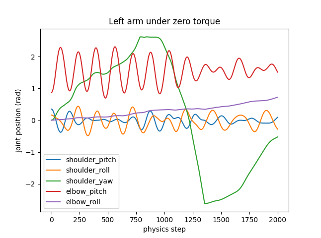
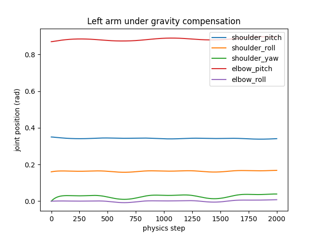
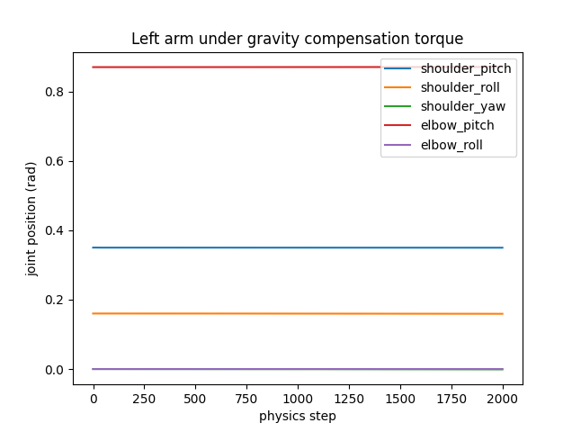
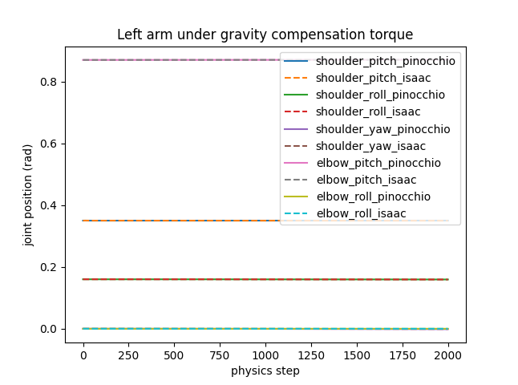

# Gravity validation: Pinocchio vs Isaac Sim

This check confirms that the Pinocchio model used by the adaptive controller computes the same
gravity torques for the G1 left arm as the robot simulated in Isaac Sim.

## Purpose
The planned controller (Slotine–Li style) computes the left-arm joint torques directly. The arm
joints run in effort mode with the built-in PD drive switched off, while the hand keeps Isaac's PD
drive. At every step the controller needs the arm dynamics (gravity $g(q)$, mass matrix $M(q)$,
Coriolis terms and, later, a payload regressor), which we compute with
[Pinocchio](https://github.com/stack-of-tasks/pinocchio) from a URDF of the robot.

The controller trusts these values completely, so Pinocchio's model must match the simulated robot.
If it does not:
1. the stability proof's assumption that the arm's parameters are known exactly is violated, and
2. the adaptation law absorbs arm-model errors into its estimate of the payload's parameters,
   which makes that estimate meaningless.

## What is compared, and why gravity first
The arm dynamics are

$$M(q)\ddot q + C(q,\dot q)\dot q + g(q) = \tau .$$

If the applied torque is exactly $g(q)$ and the arm starts at rest, the arm should stay still.
So we apply each program's gravity torques to the 5 left-arm joints and check whether the arm holds
its pose. We compare:

- **Isaac Sim (PhysX):** the articulation's own gravity compensation forces.
- **Pinocchio:** `computeGeneralizedGravity` on the URDF model, at the joint positions read from Isaac.

Gravity is checked first because it depends only on the configuration $q$. That isolates errors in
link masses, centres of mass, joint frames and the Isaac-to-Pinocchio joint mapping, without
velocity or acceleration effects.

## Files
| File | Role |
|---|---|
| `../tools/usd_to_urdf.py` | Converts the Isaac Lab G1 USD (37-DOF variant, 5-DOF arms) into a dynamics-only URDF (no meshes) |
| `my_pin_model.py` | `PinModel`: loads the URDF with a fixed base, maps Isaac's joint order to Pinocchio's by joint name, returns the 5 left-arm gravity torques |
| `validate_pin_isaac_gravity.py` | Standalone Isaac Lab environment: fixed-base G1, left-arm PD off (effort mode), applies the torques for the selected mode and logs the arm joint positions |
| `validate_test_env.py` | Runner: launches Isaac Sim, runs the environment for 10 s and saves the log |
| `plot.py` | Plots a logged run |
| `figures/` | Plots from our runs |

These scripts are kept separate from the training code.

## Requirements
See [`../requirements.txt`](../requirements.txt): Isaac Sim 6.0.1 and Isaac Lab (installed
separately), Pinocchio, PyTorch with CUDA, Warp, matplotlib, and `usd-core` for the converter.
Pinocchio must be installed in the same Python environment as Isaac Sim.

## Setup: generate the URDF
`validation/g1_37dof.urdf` is not included in this repository, because it is derived from the
Unitree G1 robot asset distributed with [Isaac Lab](https://github.com/isaac-sim/IsaacLab)
(the USD loaded by `G1_CFG` in `isaaclab_assets`). Generate it from your own copy of that asset.
From the repository root:

```bash
python -m tools.usd_to_urdf <path/to/g1.usd> validation/g1_37dof.urdf
```

Notes on the converter:
- Each link frame is placed at its parent joint frame, as URDF expects; inertias are re-expressed
  in that frame.
- Two placeholder links (`pelvis_contour_link`, `imu_link`) have an unset centre of mass in the
  USD; the converter places it at the link origin. Neither is on the arm.

## How to run
Run from the repository root, with the Python environment that has Isaac Sim, Isaac Lab and
Pinocchio. Use a single environment (`--num_envs 1`, the default): the Pinocchio mode currently
computes torques for environment 0 only.

```bash
python -m validation.validate_test_env --test_mode zero
python -m validation.validate_test_env --test_mode gravity
python -m validation.validate_test_env --test_mode pin_gravity
```

| Mode | Torque applied to the 5 left-arm joints |
|---|---|
| `zero` | none |
| `gravity` | Isaac Sim's gravity compensation torques |
| `pin_gravity` | Pinocchio's gravity torques |

Isaac Lab launcher flags such as `--headless` and `--device` also work. Each run lasts 10 s of
simulated time (2,000 physics steps at 200 Hz) and saves the left-arm joint positions of
environment 0 to `validation/logs/arm_log_<mode>.pt`.

To plot a run:

```bash
python -m validation.plot
```

`plot.py` currently plots `logs/arm_log_gravity.pt`. To plot another mode, change the file name
(and the title) in the script. The overlay figure below was made with a modified version of this
script that plots two logs together; that version is not included yet.

## Expected outcome
**`zero`: the arm falls.** With no torque and the PD drive off, the arm swings under gravity. This
confirms that the left arm is in effort mode with its PD drive off.



**`gravity`: the arm holds its pose.** With Isaac's own gravity torques, the joints stay close to
their initial positions. A small, slow drift is visible in this run, mainly in `shoulder_yaw` and
`elbow_pitch`.



**`pin_gravity`: the arm holds its pose, like `gravity`.** With Pinocchio's gravity torques, the
joints stay close to their initial positions.



**Overlay.** Joint positions under Pinocchio's torques (solid) and Isaac's torques (dashed). At this
scale the two sets of curves overlap, which indicates that Pinocchio's gravity torques agree with
Isaac Sim's (PhysX) for the left arm.


## Notes and limitations
- **Joint mapping by name.** Isaac and Pinocchio can order the joints differently, so `PinModel` maps
  each Isaac joint to Pinocchio by name, using `idx_q` for positions and `idx_v` for velocities
  and torques.
- **Fixed base in both programs.** Isaac uses `fix_root_link=True`, and the URDF is loaded without
  a floating-base joint, so the pelvis is fixed in both.
- **Not in the URDF:** joint armature, friction and damping. They do not affect gravity, but
  armature adds to the effective joint inertia, so it must be added to $M(q)$ for the full
  controller.
- **Single environment.** Pinocchio runs on the CPU for environment 0 only, and only that
  environment is logged.
- **Unused actions.** The runner still sends an action signal to the environment, but this
  environment ignores it. The hand holds its default pose with Isaac's PD drive.

## Next steps
1. **Tracking controller.** Use the full model, not only gravity:
   $$\tau = M(q)\ddot q_r + C(q,\dot q)\dot q_r + g(q) - K_D s,\qquad s = \dot q - \dot q_r,$$
   where $\dot q_r = \dot q_d - \Lambda \tilde q$ is the reference velocity and
   $\tilde q = q - q_d$ is the tracking error. This also needs $M(q)$ (with armature) and the
   Coriolis terms to be validated against Isaac.
2. **Adaptation with an unknown payload.** Write the payload's contribution with a regressor,
   $Y(q,\dot q,\dot q_r,\ddot q_r)\,\hat a$, and update the payload estimate $\hat a$ online
   (Slotine–Li adaptation law).

## Credits
The Unitree G1 robot asset and the `G1_CFG` configuration come from
[Isaac Lab](https://github.com/isaac-sim/IsaacLab) (NVIDIA). Rigid-body dynamics are computed with
[Pinocchio](https://github.com/stack-of-tasks/pinocchio).
